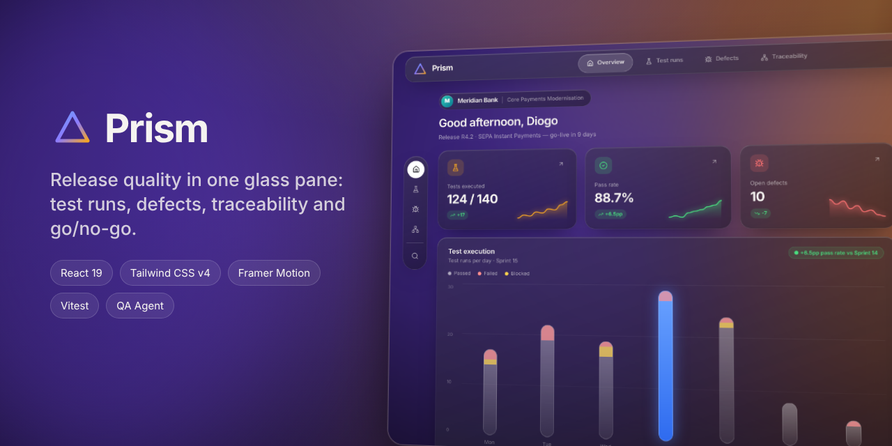
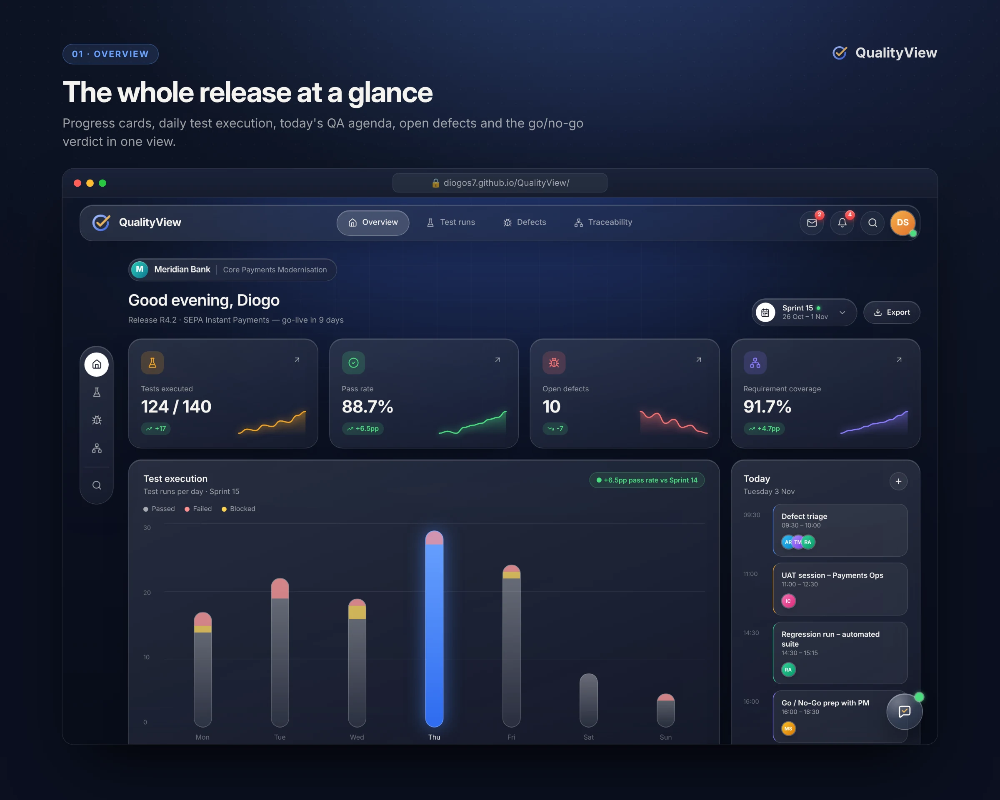
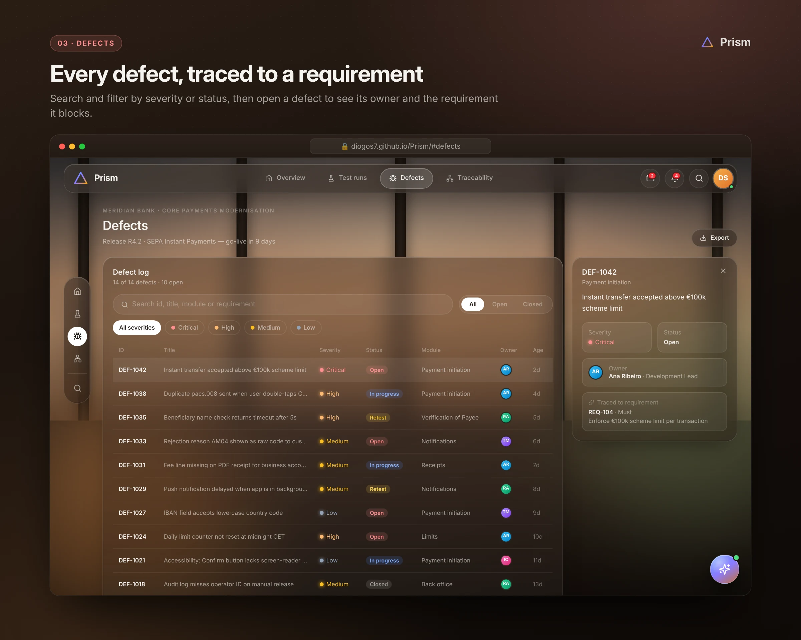
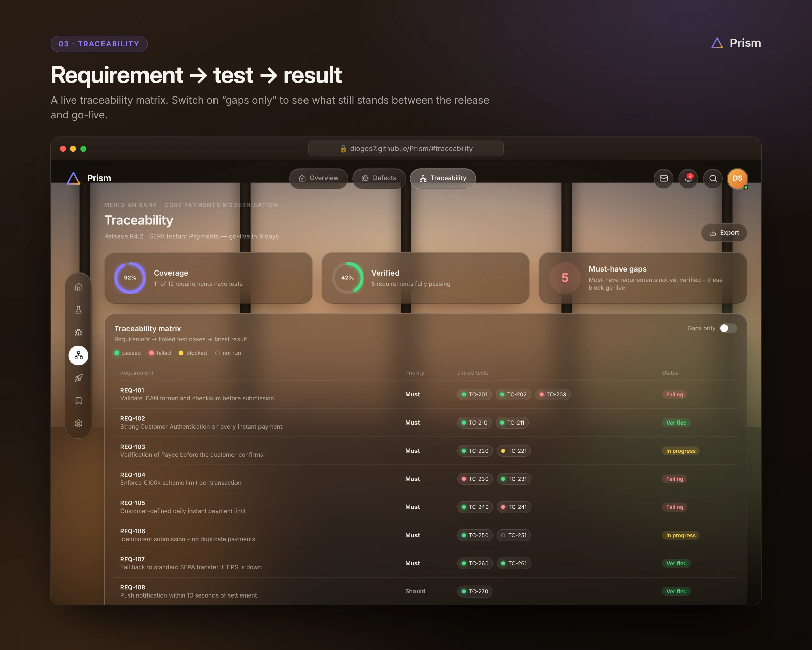
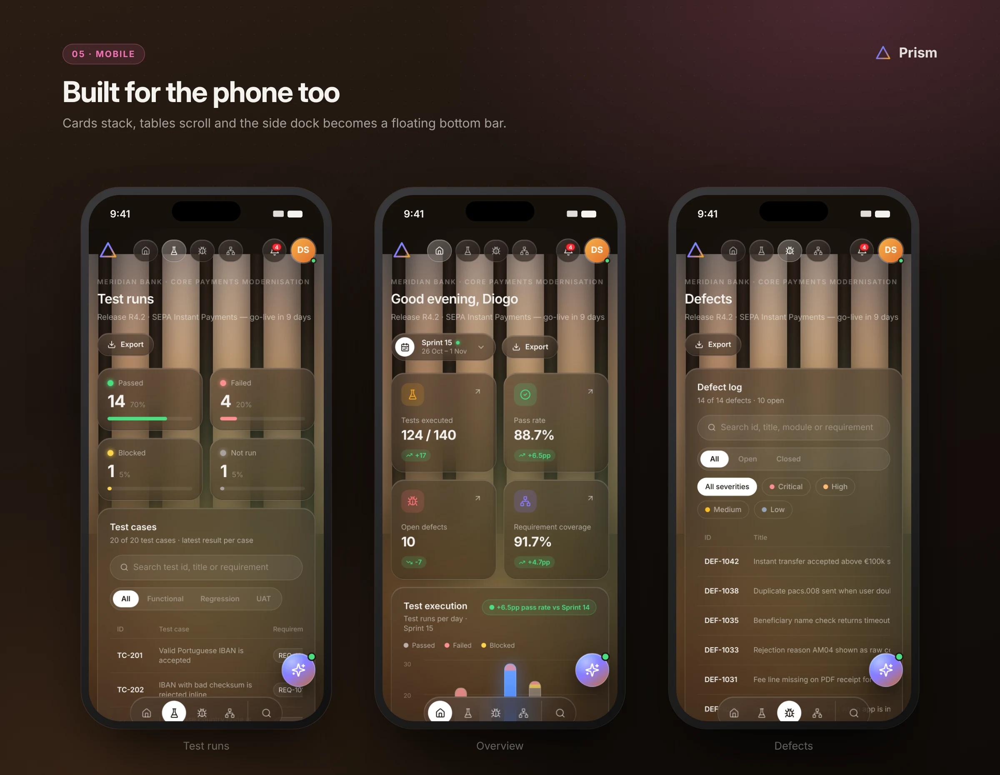
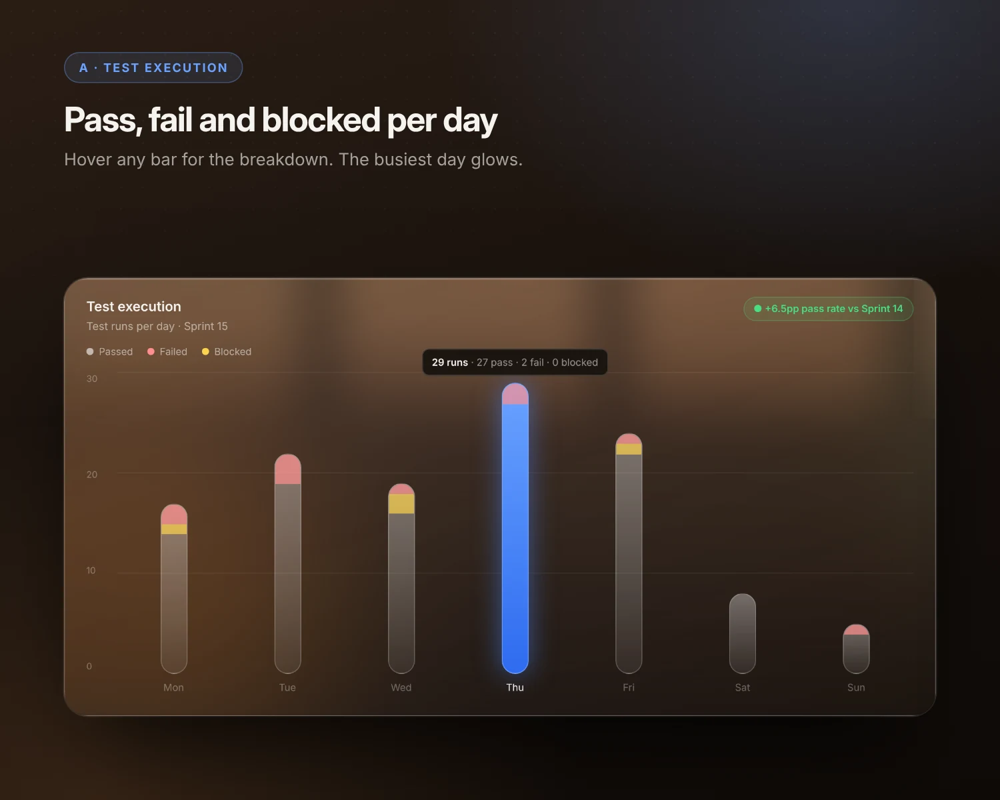
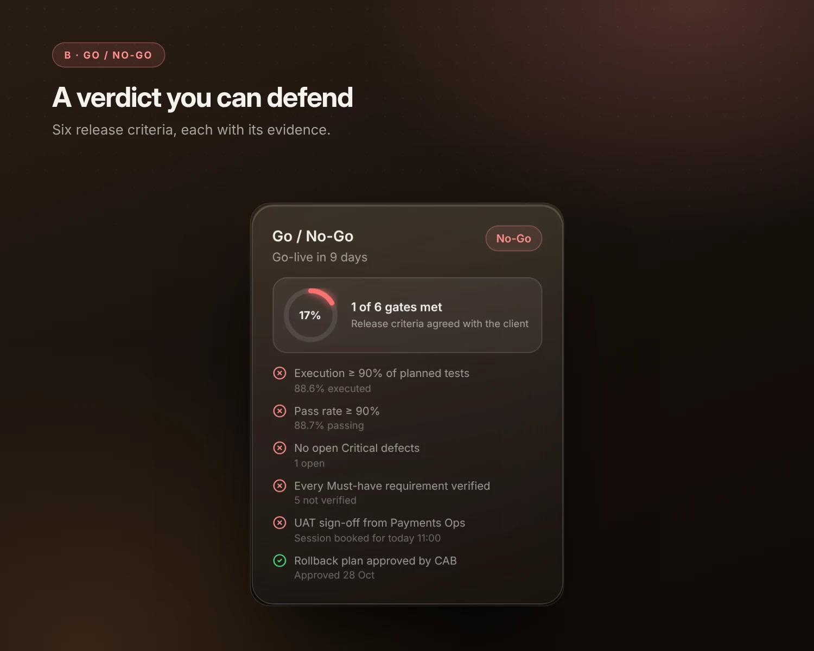
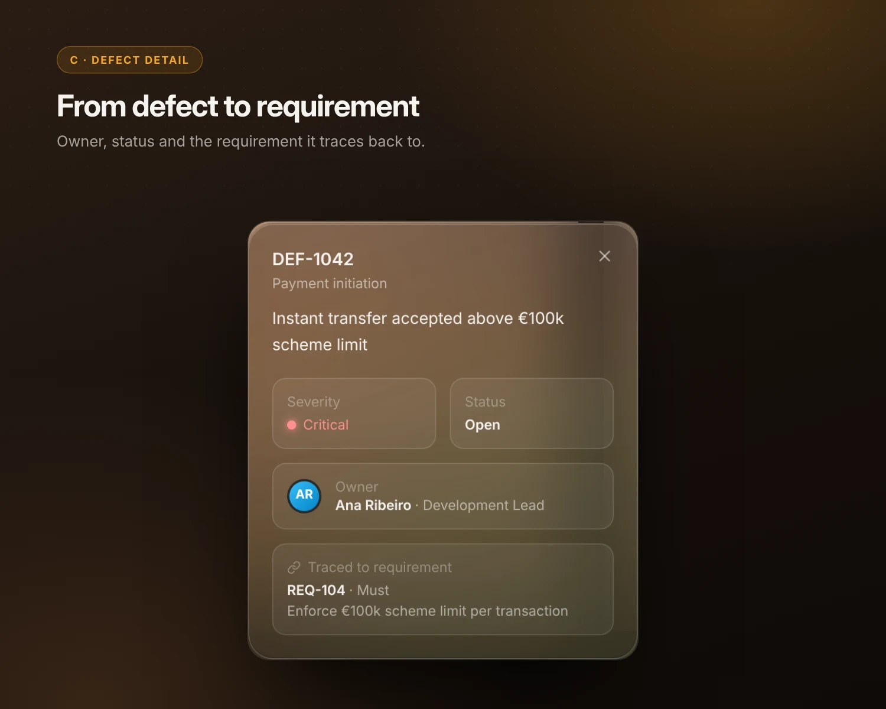

# Prism

[](https://github.com/DiogoS7/Prism/actions/workflows/ci.yml)

*Release quality in one glass pane.*

Prism is a release-quality command centre for a QA lead or delivery consultant. It brings together the four things a client asks about before go-live: how much has been tested, what is still broken, whether every requirement is covered, and whether the release meets the go/no-go criteria.

The data is a fictional release (**R4.2 · SEPA Instant Payments** for the made-up *Meridian Bank*). It is modelled on the work I do as a QA consultant in the banking sector. Every person, defect and requirement is synthetic.

**Live demo:** https://diogos7.github.io/Prism/

## Views









### Highlights

| | | |
|---|---|---|
|  |  |  |

## What it shows

- **Go/No-Go gates.** Four automatic gates (execution ≥ 90%, pass rate ≥ 90%, no open Critical defects, every Must-have verified) are calculated from the data. Two manual gates come from the client (UAT sign-off, CAB-approved rollback). An open Critical defect makes the release **No-Go**. Any other failed gate makes it **Conditional**.
- **Requirement status.** A requirement is *Verified* when every linked test passes. It is *Failing* if any test fails, *In progress* if a test is blocked or not run, and *No tests* when nothing is linked.
- **Honest deltas.** Change badges are green when the change is good news, not just when the number goes up. Fewer open defects is green.
- **Export.** Each view exports what you're looking at to CSV: execution by day, the filtered defect log or the traceability matrix.
- **Shareable views.** The current view is kept in the URL (`#defects`, `#traceability`).

## Tech stack

| | |
|---|---|
| UI | React 19, Tailwind CSS v4 (custom `glass` utility), Framer Motion |
| Icons | Lucide, via `react-icons/lu` |
| Build | Vite 7 |
| Tests | Vitest unit tests for all the metric logic (`src/lib/*.test.js`) |
| CI/CD | GitHub Actions runs the tests and the build on every push and PR, then deploys `main` to GitHub Pages |

The glass look is made of a frosted card (`backdrop-filter: blur() saturate()`), a soft top highlight and a deep drop shadow, laid over a CSS-only "room at dusk" backdrop. No images are used.

## Getting started

You need Node.js 20 or later.

```bat
cd C:\Projects\prism
npm install
npm run dev
```

Then open http://localhost:5173.

| Command | What it does |
|---|---|
| `npm run dev` | Start the dev server with hot reload |
| `npm test` | Run the unit tests once |
| `npm run test:watch` | Re-run tests on save |
| `npm run build` | Production build into `dist/` |
| `npm run preview` | Serve the production build locally |

## Project structure

```
src/
├── App.jsx              # Layout, view switching, scope toggle, CSV export
├── components/          # GlassCard, StatsCard, ExecutionChart, ReadinessCard, ...
├── views/               # Overview, Defects, Traceability
├── data/release.js      # Synthetic release data (swap in a real source here)
└── lib/
    ├── metrics.js       # Pass rate, coverage, gates, verdict, deltas, axis maths
    ├── metrics.test.js
    ├── csv.js           # CSV export
    └── csv.test.js
```

All numbers come from pure functions in `lib/metrics.js`, so the logic is tested without rendering anything. Connecting a real source such as Jira, Azure DevOps or Xray only means replacing `data/release.js`.

## Why I built it

As a QA consultant I spend a lot of each release answering the same questions in different spreadsheets. *Are we on track? What's blocking go-live? Is REQ-104 covered?* Prism puts those answers in one place, framed the way a client steering meeting asks them. It's also a chance to show front-end work alongside my Salesforce ([Launchpad](https://github.com/DiogoS7/Launchpad)) and Power Platform ([Houston](https://github.com/DiogoS7/Houston)) projects.

## License

[MIT](LICENSE) © Diogo Santos
